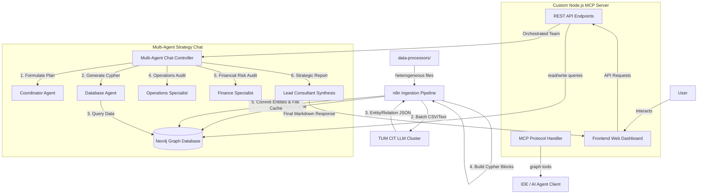

# Supply Chain Knowledge Graph & Multi-Agent Consultant Platform
## Comprehensive Technical Documentation

This document serves as the primary developer and operator guide for the GenAI Supported Supply Chain Consultant platform.

---

## 1. Project Overview & Architecture

### Goal
The platform provides a Consultant-grade AI Assistant capable of tracing, analyzing, and optimizing charging station supply chains. It does this by ingesting heterogeneous supply chain data, populating a Neo4j knowledge graph, and orchestrating a multi-agent consultant team that reasons over the data.

### System Architecture
The following Mermaid diagram shows the data flow and system interactions:



---

## 2. Component Inventory

| Component | Purpose | Location | Status |
| :--- | :--- | :--- | :--- |
| **Docker Compose** | Orchestrates Neo4j and n8n services, volumes, and networking. | [docker-compose.yml](file:///c:/Users/hoang/OneDrive%20-%20TUM/Uni/26%20SS/AI%20Agents%20in%20Practice/docker-compose.yml) | ✅ Running |
| **Ingestion Pipeline** | Data-agnostic n8n workflow for entity extraction. | Database: `workflow_entity` (ID: `FoP9rN4h7jW5gH2H`) | ✅ Active |
| **Neo4j Graph Database** | Stores nodes, relationships, and cache hashes. | Docker container `neo4j-supply-chain` | ✅ Running |
| **Custom MCP Server** | Express/TypeScript SSE and stdio server + REST API endpoints. | [mcp-server/src/index.ts](file:///c:/Users/hoang/OneDrive%20-%20TUM/Uni/26%20SS/AI%20Agents%20in%20Practice/mcp-server/src/index.ts) | ✅ Running |
| **Dashboard UI** | Client interface combining Dashboard, Ingestion Control, Graph Explorer, and Chat. | [mcp-server/public/](file:///c:/Users/hoang/OneDrive%20-%20TUM/Uni/26%20SS/AI%20Agents%20in%20Practice/mcp-server/public) | ✅ Active (Port 3000) |
| **Initialization Script** | Schema declaration for Constraints, Indexes, and Constraints. | [neo4j/init.cypher](file:///c:/Users/hoang/OneDrive%20-%20TUM/Uni/26%20SS/AI%20Agents%20in%20Practice/neo4j/init.cypher) | ✅ Matches Production |

---

## 3. Docker Infrastructure & Volumes

The environment is containerized using Docker Compose.

- **Services**:
  1. **Neo4j** (`neo4j:5.26-community`): Runs on ports `7474` (HTTP console) and `7687` (Bolt binary protocol). Uses unrestricted APOC procedures.
  2. **n8n** (`n8nio/n8n:latest`): Runs on port `5678`. Mapped to host directory `./data-processors` at `/home/node/.n8n-files` for direct file loading.
- **Volumes**:
  - `aiagentsinpractice_neo4j_data`: Reused compose-managed volume containing the ingested graph dataset.
  - `n8n_data`: Reused external volume containing n8n settings, credentials, and workflows.
- **Networks**:
  - `supply-chain-network` (bridge): Allows n8n to connect securely to Neo4j using the internal DNS hostname `neo4j`.

---

## 4. Neo4j Knowledge Graph Schema & Statistics

### Schema Definitions
- **Nodes**:
  - `ChargingStation`: Representation of EV chargers (`unit_id`, `serial_number`, `product_variant`, `country`, etc.).
  - `Process`: Represents a lifecycle activity (`process_id`, `process_name`, `lifecycle_phase`, `duration_days`, `cost_eur`, etc.). Uniquely scoped to a ChargingStation using a compound key.
  - `Actor`: Organizations in the supply chain (`actor_id`, `actor_name`, `country`, `region`).
  - `Location`: Geographic sites (`location_code`, `location_name`, `country`).
  - `Transport`: Logistics movements between locations (`transport_id`, `mode`, `distance_km`, `cost_eur`).
  - `Material`: Physical parts used during manufacturing or maintenance (`material_id`, `material_name`, `hazard_category`).
  - `ProcessedFile`: System node used to cache successfully ingested files (`name`, `hash`).

- **Relationships**:
  - `(:ChargingStation)-[:UNDERGOES]->(:Process)`
  - `(:Process)-[:EXECUTED_BY]->(:Actor)`
  - `(:ChargingStation)-[:LOCATED_IN]->(:Location)`
  - `(:Transport)-[:FOR_UNIT]->(:ChargingStation)`
  - `(:Process)-[:USES_MATERIAL]->(:Material)`
  - `(:Actor)-[:SUPPLIES]->(:Material)`

### Production Data Counts (Verification Stats)
- **Processes**: 565 nodes
- **Charging Stations**: 26 nodes
- **Locations**: 23 nodes
- **Actors**: 22 nodes
- **Materials**: 17 nodes
- **Processed Files**: 10 nodes
- **Relationships**: ~2122 total edges

---

## 5. n8n Data Ingestion Pipeline

The workflow `07_LLM_Entity_Extraction_v3_HTTP` parses all raw documents from `./data-processors/` and uses LLM-based extraction.

### Processing & Caching Flow
1. **Initialize Cache**: Fetches all existing file hashes and row hashes from Neo4j.
2. **Read Directory**: Scrapes `./data-processors/` for data files.
3. **File Cache Check**: Computes the MD5-like string hash of the file. If it matches `ProcessedFile(name, hash)`, it skips the file instantly.
4. **Row Ingestion / Batching**:
   - **CSVs**: Split into batches of **5 rows** to avoid LLM timeouts. Compares `batchHash` against existing database hashes. If a match is found, it skips the batch.
   - **Unstructured (txt, md)**: Computes a `docHash` for the entire file. If matched, it skips.
5. **Double LLM Call Loop**:
   - **Call 1 (Guided Context)**: Feeds the batch rows plus the current database state of known Actors/Locations into the LLM. The LLM resolves typos and maps raw entries to existing nodes.
   - **Call 2 (Entity Extraction)**: Performs structural extraction using the context from Call 1, outputting JSON entities and relationships.
6. **Query Construction**: A Code node compiles LLM JSON into a single atomic Cypher block. It escapes properties using backticks (e.g. `n0.\`Date Filed\``) to handle spaces and characters securely.
7. **Commit Cache**: On completing a file without errors, merges a `ProcessedFile` node in Neo4j with its file hash.

---

## 6. MCP Server Tools & REST API

The Custom Node.js server exposes Model Context Protocol capabilities as well as HTTP endpoints for the UI.

### MCP Tools (Stdio & SSE)
- `graph-query`: Runs Cypher queries. Parameters: `query`, `params`, `read_only` (default: `true`).
- `subgraph-extract`: Traverses paths around a node up to depth `N` (1-4) using `apoc.path.subgraphAll`.
- `diagram-generate`: Generates clean PlantUML specifications representing subgraphs.
- `analytics`: Performs on-the-fly bottleneck, centrality, or critical path analyses.

### REST HTTP Endpoints
- `GET /api/health`: Comprehensive status check verifying the health of the Express Server, Neo4j, n8n, and the TUM LLM Cluster.
- `POST /api/query`: Runs custom Cypher queries for the dashboard grid.
- `POST /api/subgraph`: Fetches nodes and edges for the network explorer.
- `POST /api/diagram`: Generates PlantUML source for graph structures.
- `GET /api/ingestion/status`: Scrapes the upload folder and matches file hashes against Neo4j to report ingestion statuses (Ingested vs Pending).
- `POST /api/ingestion/upload`: Endpoint to upload new supply chain CSVs or incident reports.
- `POST /api/ingestion/trigger`: Triggers n8n pipeline run via webhook.
- `POST /api/chat`: Multi-Agent Strategy assistant chat endpoint.

---

## 7. Multi-Agent Strategy Assistant

The `/api/chat` endpoint coordinates 5 specialized agent calls to solve complex supply chain queries:

1. **Coordinator Agent (Plan)**: Reviews the user query and outlines a high-level strategy detailing what data needs retrieval.
2. **Database Specialist (Cypher)**: Generates a tailored read-only Cypher query based on the database schema. The server executes this query on Neo4j.
3. **Operations Specialist (Ops)**: Evaluates the query results, focusing on lead times, bottlenecks, transport modes, and locations.
4. **Finance & Risk Specialist (Finance)**: Evaluates cost metrics, spend distributions, and single-source dependency risks.
5. **Coordinator Synthesis (Consultant)**: Pulls together the plan, operational summary, and risk assessments. Initiates a **High-Reasoning** LLM call to synthesize the final markdown strategy report, including comparative tables and actionable advice.

---

## 8. Operational Runbook & Troubleshooting

### Basic Commands
- **Start Services**:
  ```bash
  docker compose up -d
  ```
- **Stop Services**:
  ```bash
  docker compose down
  ```
- **Check Container Logs**:
  ```bash
  docker logs -f n8n-compose
  docker logs -f neo4j-supply-chain
  ```
- **Start MCP Server**:
  ```bash
  cd mcp-server
  powershell -ExecutionPolicy Bypass -Command "npx tsx src/index.ts"
  ```

### Troubleshooting SQLite Database Corruption
If n8n crashes on startup with the error `SyntaxError: Expected double-quoted property name in JSON...`, the workflow SQLite database has corrupted contents (often inside executions or the recovered index).

**How to Recover**:
1. Stop the n8n container: `docker compose stop n8n`
2. Locate the intact host database file: `current_container_db.sqlite` (or restore from the backup `database.sqlite.bak`).
3. Replace the volume's corrupted database:
   ```bash
   docker run --rm -v n8n_data:/data -v "c:/Users/hoang/OneDrive - TUM/Uni/26 SS/AI Agents in Practice:/host" alpine sh -c "cp /host/current_container_db.sqlite /data/database.sqlite && chown 1000:1000 /data/database.sqlite && chmod 777 /data/database.sqlite && rm -f /data/database.sqlite-shm /data/database.sqlite-wal /data/crash.journal"
   ```
4. Restart n8n: `docker compose start n8n`
