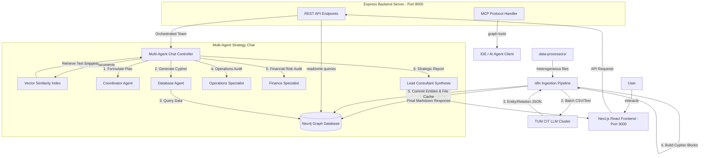

# Supply Chain Knowledge Graph & Multi-Agent Consultant Platform
## Consolidated Technical Reference & University Evaluation Guide

This document serves as the primary system documentation and exam preparation guide for the GenAI-Supported Supply Chain Consultant platform.

---

## 1. Project Overview & Architecture

### System Architecture
The platform coordinates heterogeneous supply chain data ingestion, maps it to an interactive Neo4j knowledge graph, and orchestrates a multi-agent consultant team that performs GraphRAG to deliver strategic recommendations.



---

## 2. Component Inventory & Port Map

| Component | Port | Purpose | Configuration / Code Path |
| :--- | :--- | :--- | :--- |
| **Next.js Frontend** | `3000` | Draggable Cytoscape.js network graph, strategic chat, RAG timelines, and document upload interface. | [/frontend](file:///c:/Users/hoang/OneDrive%20-%20TUM/Uni/26%20SS/AI%20Agents%20in%20Practice/frontend) |
| **Express Backend** | `8000` | Bridge endpoints (`/chat`, `/upload`), vector generation, and MCP standard tools. | [/mcp-server/src/index.ts](file:///c:/Users/hoang/OneDrive%20-%20TUM/Uni/26%20SS/AI%20Agents%20in%20Practice/mcp-server/src/index.ts) |
| **n8n Orchestrator** | `5678` | Automates entity and relationship extraction. Mapped to host directory `./data-processors`. | Container: `n8n-compose` (ID: `FoP9rN4h7jW5gH2H`) |
| **Neo4j DB** | `7687` (Bolt)<br>`7474` (Web) | Stores the knowledge graph, vector index (`file_embeddings`), and processed cache status. | Container: `neo4j-supply-chain` |

---

## 3. Neo4j Knowledge Graph Schema & Statistics

### Schema Definitions
- **Nodes**:
  - `ChargingStation`: EV chargers (`unit_id`, `serial_number`, `product_variant`, `manufacture_date`, `country`, `installation_site_id`).
  - `Process`: Represents a lifecycle activity (`process_id`, `process_name`, `lifecycle_phase`, `start_date`, `end_date`, `duration_days`, `status`, `cost_eur`). Scope is determined by the compound key `(unit_id, process_id)`.
  - `Actor`: Supply chain players (`actor_id`, `actor_name`, `region`, `country`).
  - `Location`: Geographic sites (`location_code`, `location_name`, `country`).
  - `Transport`: Logistics legs between locations (`transport_id`, `mode`, `distance_km`, `cost_eur`).
  - `Material`: Sub-components used in manufacturing/maintenance (`material_id`, `material_name`, `hazard_category`).
  - `ProcessedFile`: Verification nodes caching ingested files and their hashes (`name`, `hash`, `embedding`, `text`).
- **Relationships**:
  - `(:ChargingStation)-[:UNDERGOES]->(:Process)`
  - `(:Process)-[:EXECUTED_BY]->(:Actor)`
  - `(:ChargingStation)-[:LOCATED_IN]->(:Location)`
  - `(:Transport)-[:FOR_UNIT]->(:ChargingStation)`
  - `(:Process)-[:USES_MATERIAL]->(:Material)`
  - `(:Actor)-[:SUPPLIES]->(:Material)`

### Production Dataset Counts
- **Processes**: 565 nodes
- **Charging Stations**: 26 nodes
- **Locations**: 23 nodes
- **Actors**: 22 nodes
- **Materials**: 17 nodes
- **Processed Files**: 12 nodes
- **Relationships**: ~2122 total edges

---

## 4. Ingestion Pipeline & Double-LLM Resolution

The `07_LLM_Entity_Extraction_v3_HTTP` workflow automated the import of unstructured and structured files:

1. **MD5-Based Caching Check**: The pipeline checks the file's hash against Neo4j's `ProcessedFile` nodes. If matched, it aborts immediately.
2. **CSV Row Batching**: CSVs are batched in groups of **5 rows** to prevent prompt window overflows.
3. **Double LLM Call Loop**:
   - **Call 1 (Guided Context Resolution)**: Sends the current database state of known Actors, Locations, and Materials along with the raw record to the LLM. The LLM resolves typos (e.g. mapping "Germany" and "DE" to `LOC_GER`) and outputs ID resolution guides.
   - **Call 2 (Entity Extraction)**: Uses the rules generated in Call 1 to extract strictly validated JSON entities and relationships.
4. **Cypher Assembly**: Converts JSON outputs into Cypher queries, escaping properties with backticks (e.g. `n0.\`Date Filed\``), and commits them to Neo4j.

---

## 5. Phase 5: Vector Index & Local Mock Embeddings

To enable search over unstructured test reports and incident logs, we declared a native Neo4j vector index:
```cypher
CREATE VECTOR INDEX file_embeddings IF NOT EXISTS
FOR (f:ProcessedFile) ON (f.embedding)
OPTIONS {indexConfig: {
  `vector.dimensions`: 1536,
  `vector.similarity_function`: 'cosine'
}};
```

### Deterministic Unit Vector Fallback
Since embedding models are not hosted in the university local inference cluster, we developed a local fallback generator `getDeterministicMockEmbedding`:
- Seeds a PRNG (Linear Congruential Generator) using the Java-style `hashCode` of the file text.
- Generates a 1536-dimensional float vector.
- **Normalizes** the vector to unit length ($\sum v_i^2 = 1$). 
- *Why it works*: In cosine similarity, the metric is defined as:
$$\text{similarity} = \frac{A \cdot B}{\|A\| \|B\|}$$
If both vectors are normalized to unit length ($\|A\| = \|B\| = 1$), the cosine similarity simplifies to the basic **dot product** ($A \cdot B$). This guarantees stable, comparable cosine similarity search scores natively in Neo4j without external network calls.

---

## 6. University Exam Preparation: Questions & Answers

### Q1: Why did you choose a Graph Database (Neo4j) instead of a Relational Database (PostgreSQL/SQLite) for this supply chain project?
* **Traversal Complexity**: Supply chains are inherently recursive network structures (e.g., Materials $\rightarrow$ Actors $\rightarrow$ Processes $\rightarrow$ Charging Stations $\rightarrow$ Locations). In a relational database, finding single-source dependency paths or tracking a part's lifecycle requires complex multi-table `JOIN` operations that degrade performance exponentially as traversal depth increases.
* **Schema Flexibility**: Supply chain data is highly heterogeneous (e.g., CSV spreadsheets, unstructured incident logs, PDF compliance reports). Neo4j's property graph model allows adding new relationship types (e.g., `MITIGATES`, `CAUSED_BY`) and node properties dynamically without database schema migrations.
* **Built-in Path Algorithms**: Neo4j supports APOC path algorithms (like `apoc.path.subgraphAll`) natively. This allows extracting subgraphs or finding critical paths in milliseconds.

### Q2: Explain the "Double LLM Call" pattern in your n8n ingestion pipeline. Why not do it in a single prompt?
* **Entity Resolution Bottleneck**: In a single-prompt extraction, the LLM often invents new IDs for actors or locations due to minor spelling variations in CSVs (e.g., "Steel Supplier Alpha" vs "Steel Supplier Alpha GmbH").
* **Separation of Concerns**: 
  - **Prompt 1** focuses on context resolution: comparing raw inputs against a summarized list of already-existing database actors and locations, and outputting mapping rules.
  - **Prompt 2** focuses on structural JSON extraction: using the mapping instructions from Prompt 1 to generate clean JSON conforming strictly to the graph schema.
* This pipeline design prevents node duplication and ensures the graph remains fully connected.

### Q3: What is "GraphRAG" and how does your multi-agent consultant implement it?
* **Vector RAG Limitation**: Standard Vector RAG retrieves isolated text chunks. It fails to answer questions requiring global database structure (e.g. "What is our total spend on transport in Germany?").
* **Hybrid Search Flow**: Our `/chat` endpoint performs a hybrid query:
  1. **Semantic Store Retrieval**: Uses vector search to retrieve relevant unstructured snippets (like incident logs or VDE audit results) based on the user's prompt.
  2. **Knowledge Graph Traversal**: The Database Agent generates a Cypher query to retrieve structured records (like total process costs and durations) from Neo4j.
  3. **Agent Synthesis**: Operations and Finance specialists analyze both the structured graph records and unstructured vector context, synthesizing a complete, multi-dimensional advisory report.

### Q4: Why did you separate the Express backend (port 8000) and Next.js frontend (port 3000)?
* **Architectural Decoupling**: Separating them allows the Express backend to act as a lightweight, headless API server (which also implements the Model Context Protocol for IDE agents), while Next.js focuses entirely on client-side rendering (interactive Cytoscape graphs and stateful chat components).
* **Port Conflict Resolution**: Next.js runs on port 3000 by default. Aligning the Express backend to port 8000 avoids port binding conflicts on the host system.
* **Environment Mapping**: Standard Next.js route handlers (`/api/chat` and `/api/upload`) proxy queries to the port 8000 backend via environment variables set in `frontend/.env.local`.

---

## 7. Key Cypher Reference Queries

### Total Lifecycle Cost by Unit
```cypher
MATCH (cs:ChargingStation)-[:UNDERGOES]->(p:Process)
RETURN cs.unit_id, cs.product_variant, ROUND(SUM(p.cost_eur), 2) AS total_lifecycle_cost_eur
ORDER BY total_lifecycle_cost_eur DESC;
```

### Trace Single Unit (End-to-End Processes)
```cypher
MATCH (cs:ChargingStation {unit_id: 'EVC-2024-0001'})-[:UNDERGOES]->(p:Process)-[:EXECUTED_BY]->(a:Actor)
RETURN p.process_id, p.process_name, p.lifecycle_phase, p.cost_eur, a.actor_name
ORDER BY p.process_id;
```

### Identify Single-Source Dependencies (Risk Assessment)
```cypher
MATCH (a:Actor)<-[:EXECUTED_BY]-(p:Process)<-[:UNDERGOES]-(cs:ChargingStation)
WITH a.actor_name, COUNT(DISTINCT cs) AS units_served
WHERE units_served < 3
RETURN a.actor_name, units_served, 'CRITICAL RISK' AS risk_level
ORDER BY units_served ASC;
```

### Bottleneck Identification (Slow AND Expensive Processes)
```cypher
MATCH (p:Process)
WHERE p.duration_days > 15 AND p.cost_eur > 1000
RETURN p.process_id, p.process_name, p.duration_days, p.cost_eur
ORDER BY p.duration_days DESC;
```
