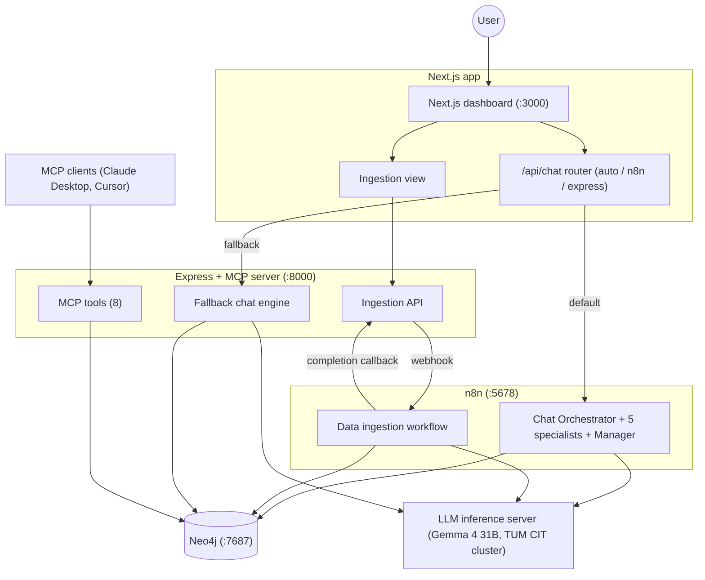

# GenAI Agents for Supply Chain Analysis

A data-agnostic, end-to-end platform that turns heterogeneous supply chain data (CSV exports, ERP tables, emails, inspection reports, meeting minutes, field notes) into a **Neo4j knowledge graph**, and lets users question that graph through a **multi-agent GraphRAG system** in a web dashboard.

The bundled sample dataset follows the lifecycle of an EV charging station (procurement, production, transport, installation, maintenance, end-of-life), but the pipeline is built to accept other supply chain domains.

> Built for the *AI Agents in Practice* practical course at the Technical University of Munich (TUM), project 19 "GenAI Agents for Supply Chain Analysis", by Khushi Vora and Duy Hoang.

---

## Features

- **Hybrid ingestion (n8n):** structured CSVs are merged into the graph deterministically (no LLM calls); unstructured text runs through a two-stage LLM pipeline (entity resolution against the live graph, then extraction to Cypher).
- **Knowledge graph + vector search (Neo4j):** documents are chunked and embedded into native Neo4j vector indexes for retrieval-augmented answers.
- **Multi-agent chat:** an n8n orchestrator routes each question to up to five specialist agents (Risk, Quality, Procurement, Logistics, Sustainability), each writing its own Cypher; a Manager agent combines their findings with retrieved document chunks.
- **Fallback engine:** an Express-based multi-agent pipeline answers when n8n is unavailable (`auto` mode tries n8n first).
- **Evidence trace:** every answer shows the tools used, generated Cypher, accessed nodes, and source chunks, plus an interactive Cytoscape graph.
- **MCP server:** the backend exposes the graph as 8 [Model Context Protocol](https://modelcontextprotocol.io) tools for clients such as Claude Desktop or Cursor.
- **Dashboard:** lifecycle overview, graph explorer (guided search, raw Cypher, table view), file ingestion with live progress, chat, and settings.

---

## Architecture



| Component | Port | Code |
| :--- | :--- | :--- |
| Next.js dashboard | `3000` | [`frontend/`](./frontend) |
| Express backend + MCP server | `8000` | [`mcp-server/`](./mcp-server) |
| n8n workflows | `5678` | [`n8n-workflows/`](./n8n-workflows) |
| Neo4j | `7687` (Bolt), `7474` (browser) | [`neo4j/init.cypher`](./neo4j/init.cypher) |

---

## Repository layout

```text
├── data-processors/   # Sample dataset (CSV, TXT, MD); also the upload directory mounted into n8n
├── frontend/          # Next.js 16 / React 19 dashboard
├── mcp-server/        # Express backend: REST API, fallback chat engine, MCP server, embeddings
├── n8n-workflows/     # Exported n8n workflows (ingestion, chat orchestrator, agents) + guides
├── neo4j/             # Schema constraints and indexes
├── docs/              # Engineering notes
└── docker-compose.yml # Neo4j + n8n
```

---

## Getting started

### Prerequisites

- Docker with Docker Compose
- Node.js 20+
- An API key for an OpenAI-compatible inference endpoint (the project uses the TUM CIT cluster running `google/gemma-4-31B-it`)
- Optional: a Gemini API key for embeddings (without one, a deterministic local fallback is used)

### 1. Configure the environment

```bash
cp .env.example .env                        # used by Docker Compose / n8n
cp mcp-server/.env.example mcp-server/.env  # used by the backend
```

Set `CLUSTER_API_KEY` (and optionally `GEMINI_API_KEY`) in both files.

### 2. Start Neo4j and n8n

```bash
docker volume create n8n_data
docker compose up -d
```

- Neo4j browser: http://localhost:7474 (`neo4j` / `neo4jPASSWORD`)
- n8n: http://localhost:5678

### 3. Import the n8n workflows

1. In n8n, install the community node package `n8n-nodes-neo4j` (*Settings → Community Nodes*).
2. Create a Neo4j credential pointing to `bolt://neo4j:7687`, and an OpenAI-type credential holding your cluster API key.
3. Import every JSON file in [`n8n-workflows/`](./n8n-workflows), assign the credentials, and activate the **Data ingestion** and **Chat Orchestrator** workflows.

See [`n8n-workflows/README.md`](./n8n-workflows/README.md) for details.

### 4. Start the backend

```bash
cd mcp-server
npm install
npm run dev
```

On startup the server creates the vector indexes and embeds any ingested files that are still missing embeddings.

### 5. Start the dashboard

```bash
cd frontend
npm install
npm run dev
```

Open http://localhost:3000, upload files in the **Ingestion** tab (or click *Trigger n8n Ingestion* to process the bundled sample data), then ask questions in the **Chat** tab.

---

## How it works

### Ingestion

The n8n workflow (`07_LLM_Entity_Extraction_v3_HTTP`) is triggered by the backend through a webhook and routes each file by type:

- **CSV (deterministic):** an `ENTITY_CONFIG` map assigns known files (e.g. `01_charging_stations.csv`, `erp_purchase_orders.csv`) to node labels, primary keys, and relationships. Rows are merged in batches of 25 with `UNWIND` + APOC. Unknown CSVs fall back to heuristics (label from file name, key from ID-like headers).
- **Unstructured text (`.txt`, `.md`, `.html`):** a content hash is checked against `ProcessedFile` nodes to skip duplicates. LLM call 1 resolves mentions against entities already in the graph (e.g. "Germany" → `LOC_GER`); LLM call 2 extracts entities and relationships as JSON, which is turned into `MERGE` queries.

When the workflow finishes, it calls back to the backend, which chunks the new documents and writes embeddings to the `ProcessedChunk` vector index.

### Chat

- **n8n engine (default):** the Chat Orchestrator runs a vector search, selects specialists by keyword, runs them in sequence (each generates and executes its own Cypher), and passes everything to the Manager agent for the final answer and evidence trace.
- **Express engine (fallback):** a Coordinator plans the query, a Database Specialist writes Cypher against the live schema, Operations and Finance/Risk specialists analyse the results in parallel, and a Lead Consultant writes the answer.
- **Auto:** tries n8n first and falls back to Express on failure or timeout.

### Vector search

Two Neo4j vector indexes (`file_embeddings`, `chunk_embeddings`, 1536 dimensions, cosine) store document and chunk embeddings. Without a `GEMINI_API_KEY`, embeddings come from a deterministic, seeded, unit-normalised pseudo-random vector so the index stays usable offline. These fallback vectors keep the pipeline running but carry no semantic meaning.

### MCP tools

| Tool | Purpose |
| :--- | :--- |
| `graph-query` | Run a Cypher query (read-only by default) |
| `subgraph-extract` | Extract the neighbourhood of a node via APOC |
| `diagram-generate` | Render nodes and relationships as PlantUML |
| `analytics` | Bottleneck (in-degree), critical path, or degree centrality analysis |
| `vector-search` | Semantic search over document chunks |
| `schema-inspect` | List labels, relationship types, and property keys |
| `file-list` | List ingested files and their embedding status |
| `ingest-file` | Trigger the n8n ingestion pipeline |

See [`mcp-server/MCP_QUICKSTART.md`](./mcp-server/MCP_QUICKSTART.md) for client setup.

---

## Testing

```bash
cd mcp-server && npm test      # unit tests (hashing, Neo4j type conversion, Cypher guard, chunker, rate limiter)
cd mcp-server && npx tsc --noEmit
cd frontend && npx tsc --noEmit
```

---

## Further reading

- [`docs/engineering-notes.md`](./docs/engineering-notes.md): design decisions and lessons learned
- [`n8n-workflows/01_DATA_INGESTION_GUIDE.md`](./n8n-workflows/01_DATA_INGESTION_GUIDE.md): ingestion workflow in detail
- [`n8n-workflows/02_CHAT_SYSTEM_GUIDE.md`](./n8n-workflows/02_CHAT_SYSTEM_GUIDE.md): chat agents in detail
