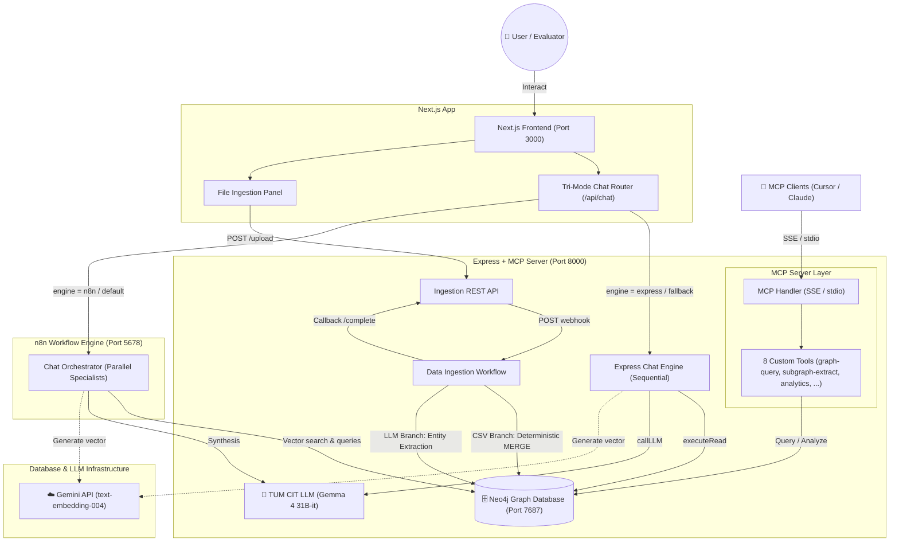

# GenAI-Supported EV-Charger Supply Chain Lifecycle Consultant

**University:** Technical University of Munich (TUM)  
**Course:** AI Agents in Practice (Practical Course)  
**Project:** 19 - GenAI-Agents for Supply Chain Analysis  
**Students:** Khushi Vora, Duy Hoang (Information Systems B.Sc.)  
**Status:** Completed (Phases 1-8 Consolidated)

---

## 🎯 Project Overview

This platform implements an **agentic supply chain pipeline** that processes heterogeneous lifecycle data (CSV execution logs, transport spreadsheets, technician notes, incident logs, VDE quality audit reports) to:
1. Extract semantic entities and relationships using a robust n8n double-LLM resolution workflow.
2. Build an interactive **Neo4j Knowledge Graph** representing the EV-charger lifecycle.
3. Index unstructured documents with a native Neo4j **Vector Similarity Search** for semantic RAG.
4. Orchestrate a **Multi-Agent Consultant Team** (Coordinator, Database Specialist, Operations Auditor, Finance Risk Specialist) via Express & Next.js to deliver strategical supply chain consulting reports with interactive Cytoscape network diagrams.

---

## 🏗️ Folder Structure

```text
├── data-processors/      # Folder containing raw CSVs, unstructured text reports, and PDFs
├── frontend/             # Next.js React frontend dashboard (Port 3000)
├── mcp-server/           # Custom Express backend server and MCP standard tools (Port 8000)
├── n8n-workflows/        # Exported JSON and markdown workflow configurations (Port 5678)
├── neo4j/                # Initialization Cypher queries and constraints scripts
├── docker-compose.yml    # Docker services orchestration (Neo4j & n8n)
├── README.md             # This folder-level index & deployment guide
└── walkthrough.md        # Operations walkthrough with screenshot and video verifications
```

---

## 🔌 System Architecture & Port Map

The platform coordinates heterogeneous supply chain data ingestion, maps it to an interactive Neo4j knowledge graph, and orchestrates a multi-agent consultant team that performs GraphRAG to deliver strategic recommendations.



### Component Port Map
| Component | Port | Purpose | Configuration / Code Path |
| :--- | :--- | :--- | :--- |
| **Next.js Frontend** | `3000` | Draggable Cytoscape.js network graph, strategic chat, RAG timelines, and document upload interface. | [frontend](./frontend) |
| **Express Backend** | `8000` | Bridge endpoints (`/chat`, `/upload`), vector generation, and MCP standard tools. | [mcp-server/src/index.ts](./mcp-server/src/index.ts) |
| **n8n Orchestrator** | `5678` | Automates entity and relationship extraction. Mapped to host directory `./data-processors`. | Container: `n8n-compose` (ID: `FoP9rN4h7jW5gH2H`) |
| **Neo4j DB** | `7687` (Bolt)<br>`7474` (Web) | Stores the knowledge graph, vector index (`file_embeddings`), and processed cache status. | Container: `neo4j-supply-chain` |

---

## 🚀 Quick Start Guide

Follow these steps to deploy and run the entire platform on your local machine:

### 1. Launch Docker Infrastructure (Neo4j & n8n)
Start the background services using Docker Compose:
```bash
docker compose up -d
```
*Verification*: Ensure both containers are healthy:
- Neo4j Web Console: http://localhost:7474 (credentials: `neo4j` / `neo4jPASSWORD`)
- n8n Workflow Panel: http://localhost:5678 (workflow `07_LLM_Entity_Extraction_v3_HTTP` is active)

### 2. Launch Express Backend Server
Navigate to the `mcp-server` directory, install packages, and start the server:
```bash
cd mcp-server
npm install
powershell -ExecutionPolicy Bypass -Command "npx tsx src/index.ts"
```
*Expected Startup Logs*:
```text
Supply Chain MCP Server listening on http://localhost:8000
[Embedding Init] Initializing vector embeddings...
[Embedding Init] Vector index 'file_embeddings' verified.
[Embedding Init] Found 12 ProcessedFile nodes in Neo4j.
[Embedding Init] Updated 12 files with vector embeddings.
[Embedding Startup] Done initializing vector embeddings.
```

### 3. Launch Next.js Frontend Dashboard
In a new terminal window, navigate to the `frontend` directory, install packages, and start the dev server:
```bash
cd frontend
npm install
powershell -ExecutionPolicy Bypass -Command "npm run dev"
```
Direct Next.js run if shell wrappers fail:
```bash
node node_modules/next/dist/bin/next dev
```
*Access URL*: Open your browser and navigate to **http://localhost:3000** to interact with the console.

---

## 📥 Hybrid Data Ingestion Pipeline (CSV vs. LLM)

The n8n data ingestion pipeline (`07_LLM_Entity_Extraction_v3_HTTP`) automatically processes uploaded files using two different execution branches:

### A. Deterministic CSV Ingestion
For structured tabular database files (CSVs):
1. **Schema Mapping Map (`ENTITY_CONFIG`):** The workflow utilizes a predefined configuration mapping matching each known CSV file (e.g. `01_charging_stations.csv`, `erp_purchase_orders.csv`) to specific Neo4j Labels (e.g. `ChargingStation`, `PurchaseOrder`), primary keys, and relationship structures (e.g. `LOCATED_IN`, `ORDERS_MATERIAL`).
2. **High-Speed Import:** CSVs are split into 25-row chunks and imported directly into Neo4j via parameterized Cypher commands using `UNWIND` and `apoc.merge.node`/`apoc.merge.relationship` statements. This guarantees 100% ingestion accuracy, rapid execution (milliseconds), and zero LLM token costs.
3. **Fallback Heuristics:** Unknown CSVs are dynamically converted by casing filenames to node labels and scanning headers for ID fields.

### B. Double-LLM Unstructured Ingestion
For unstructured text reports (`.txt`, `.md`, `.html`):
1. **MD5-Based Ingestion Cache:** Checks file hash against `ProcessedFile` nodes in Neo4j to abort duplicate uploads.
2. **Stage 1 (Context Resolution - LLM Call 1):** Injects live database state (Actors, Locations, Materials) and asks the LLM to resolve spelling/typo variations (e.g. mapping "Germany" to the location code `LOC_GER`).
3. **Stage 2 (Entity Extraction - LLM Call 2):** Extracts validated JSON conformant with schema constraints and outputs Cypher merge queries to link entities into the graph.

---

## 🔀 Dual-Engine Chat Orchestration (n8n vs. Express)

To deliver comprehensive advisory recommendations, the frontend's `/api/chat` router supports three engine configurations:

1. **n8n Orchestrator (Default & Primary):** Dispatches query payloads to the n8n Chat Orchestrator workflow. It performs a parallel Neo4j vector search, uses a Keyword Router node to selectively trigger relevant domain experts (Logistics, Procurement, Risk, Quality, Sustainability), and consolidates findings through a Manager agent.
2. **Express MCP Engine (Backup Fallback):** Dispatches to a sequential 4-agent code pipeline: Coordinator (planning) $\rightarrow$ DB Specialist (Cypher query) $\rightarrow$ Operations Specialist (logistics/times) $\rightarrow$ Finance/Risk Specialist (spend/dependencies), synthesized by a Lead Strategy Consultant.
3. **Auto Engine (Highly Resilient):** Tries the n8n Orchestrator first. If offline or timed out, it seamlessly routes the query to the local Express MCP fallback engine.

---

## ⚙️ Custom Model Context Protocol (MCP) Server

The Express backend implements the standard Model Context Protocol (MCP) over Streamable HTTP (SSE) and stdio transports, exposing **8 custom tools** strictly superior to the official Neo4j MCP implementation:

| Tool Name | Scope | Description |
| :--- | :--- | :--- |
| **`graph-query`** | Database | Executes Cypher queries against Neo4j (supports read-only `executeRead` block). |
| **`subgraph-extract`** | Exploration | Traverses surrounding nodes around a key entity using APOC `subgraphAll`. |
| **`diagram-generate`** | Visualization | Generates renderable PlantUML text representing query subgraphs. |
| **`analytics`** | Logic | Runs computed Graph Analytics (bottlenecks, critical path, degree centrality). |
| **`vector-search`** | Retrieval | Performs similarity searches over unstructured text nodes. |
| **`schema-inspect`** | Introspection | Returns database labels, relationships, and property keys. |
| **`file-list`** | Pipeline | Lists all ingested files, hashes, and embedding statuses. |
| **`ingest-file`** | Pipeline | Programmatically triggers the n8n data ingestion workflow. |

---

## ☁️ Vector Search Index & Mock Embedding Math

To support semantic RAG over unstructured incident logs and test reports, we declare a native Neo4j vector index:
```cypher
CREATE VECTOR INDEX file_embeddings IF NOT EXISTS
FOR (f:ProcessedFile) ON (f.embedding)
OPTIONS {indexConfig: {
  `vector.dimensions`: 1536,
  `vector.similarity_function`: 'cosine'
}};
```

### Deterministic Unit Vector Fallback Math
If no `GEMINI_API_KEY` is provided, the backend falls back to `getDeterministicMockEmbedding` to ensure index compatibility:
1. Seeds a pseudo-random number generator (LCG) using the Java-style `hashCode` of the text string.
2. Generates a 1536-dimensional float vector.
3. **Normalizes** the vector to unit length ($\sum v_i^2 = 1$).
4. Since cosine similarity is defined as:
$$\text{similarity} = \frac{A \cdot B}{\|A\| \|B\|}$$
When vectors are normalized ($\|A\| = \|B\| = 1$), the cosine similarity simplifies directly to the native **dot product** ($A \cdot B$). This guarantees stable, comparable, and functional vector searches directly inside Neo4j without external API dependencies.

---

## 📚 Essential Reading

To understand the codebase in detail, prepare for university evaluations, and see system execution records, read:
- **[walkthrough.md](./walkthrough.md)**: Displays browser screens and video recordings verifying that chat queries retrieve GraphRAG data and render interactive Cytoscape network diagrams.
