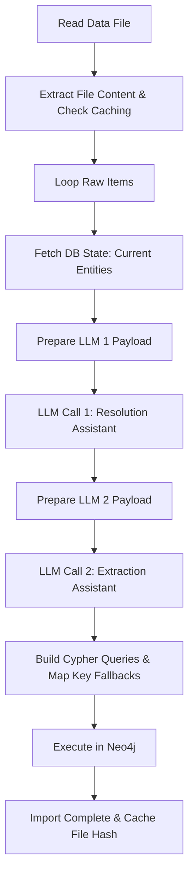

# n8n GraphRAG Ingestion Pipeline Guide
## AI-Powered Dynamic Supply Chain Knowledge Graph Ingestion

This guide documents the design, execution flow, and configuration of the advanced **07_LLM_Entity_Extraction_v3_HTTP** (Data Ingestion) workflow.

---

## 1. Workflow Architecture Overview

The ingestion pipeline is a dynamic, multi-stage GraphRAG workflow that reads raw structured (CSV) or unstructured (TXT, MD) data files, performs dynamic entity resolution against active database states, and inserts resolved node structures and relationships into Neo4j.



---

## 2. Step-by-Step Execution Flow

### Phase 1: Data Trigger & Parsing (`Read Data File` & `Extract File Content`)
- **File Directory:** Scans `/home/node/.n8n-files/*` for raw files.
- **Cache Check:** Calculates an MD5 hash of the raw text and compares it against `existing_files` in the database to prevent duplicate ingestion.
- **Batch Processing:** Splits CSV rows into batches of **5 records** at a time. Each batch has its content hashed and compared against `existing_hashes` for row-level duplicate detection.

### Phase 2: Dynamic Entity Resolution (`Fetch DB State` & `LLM Call 1`)
- **DB Fetch:** Queries Neo4j for all current entities (Actors, Locations, Materials, ChargingStations) before processing each batch.
- **Resolution Prompt:** The `Resolution Assistant` (LLM 1) takes the raw CSV batch and the lists of existing entities, performing semantic matching. 
- **Deterministic Mapping:** If the raw record contains `"Steel Supplier Alpha GmbH"`, the LLM resolves it to the existing ID `A1` based on the database state. If it is a new entity, it generates an ID following the naming conventions (e.g., `A18`, `LOC_GER`, `MAT_3`).

### Phase 3: Entity Extraction (`LLM Call 2`)
- The `Extraction Assistant` (LLM 2) takes the mapping instructions from LLM 1 and the raw batch.
- It extracts a valid JSON output containing all resolved `entities` and `relationships` with their raw property fields:
  ```json
  {
    "entities": [
      { "entity_type": "Actor", "canonical_id": "A1", "properties": { "name": "Steel Supplier Alpha", "country": "Germany" } }
    ],
    "relationships": [
      { "from_type": "Actor", "from_id": "A1", "relationship_type": "LOCATED_IN", "to_type": "Location", "to_id": "LOC_GER", "properties": {} }
    ]
  }
  ```

### Phase 4: Dynamic Query Building (`Build Cypher Queries` & `Execute`)
- **Key Fallbacks:** The node property mapper inspects the extracted labels and matches the merge keys dynamically:
  - `Actor` maps to `actor_id`
  - `Location` maps to `location_code`
  - `ChargingStation` maps to `unit_id`
  - `Process` maps to `process_id`
  - `Material` maps to `material_id`
  - Unknown custom types map to `id`
- **Execution:** Resolves parameters and runs `MERGE` queries atomically on Neo4j.
- **Cache Commit:** Inserts the batch hashes into `ProcessedChunk` and the file hash into `ProcessedFile` nodes in Neo4j to seal the ingestion cache.

---

## 3. Supported Entity Resolution Rules

To maintain high data quality and avoid graph fragmentation, the LLM is instructed on the following defaults:
1. **Canonical Actor Mappings:** If an actor name matches an active actor (e.g. `Steel Supplier Alpha`), it resolves to its ID (`A1`).
2. **Location Mappings:** Resolves cities and countries into region codes (e.g., `LOC_GER=Germany`, `LOC_VIE=Vietnam`).
3. **Compound Process IDs:** Processes are mapped using the format `<unit_id>_<process_id>` (e.g., `EVC-2024-0001_P01`).
4. **Generalization:** Unrecognized custom entity types (e.g., `Retailer`, `Supplier`) are dynamically assigned standard IDs (`RETAILER_1`) and merged on their `id` property.

---

## 4. How to Run Ingestion

1. Place your data files (CSV, TXT, or MD) in the folder mapped to `/home/node/.n8n-files/` inside the n8n container.
2. In the n8n interface, open the **07_LLM_Entity_Extraction_v3_HTTP** workflow.
3. Click **Execute Workflow**.
4. Monitor the logs. Once complete, you can verify the results in the Neo4j Browser or the Portal's **Explorer** tab.
