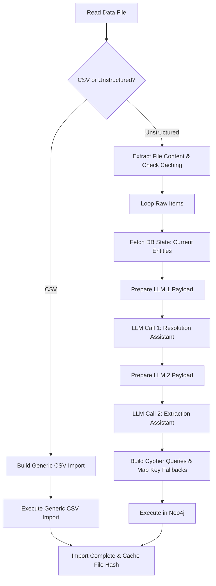

# n8n GraphRAG Ingestion Pipeline Guide
## AI-Powered & Deterministic Supply Chain Knowledge Graph Ingestion

This guide documents the design, execution flow, and configuration of the **Data ingestion workflow.json** (registered in n8n as **07_LLM_Entity_Extraction_v3_HTTP**).

---

## 1. Workflow Architecture Overview

The ingestion pipeline is a hybrid workflow. It dynamically routes incoming files based on their type:
1. **Structured Data (CSVs)**: Processed deterministically in code via a mapping configuration, bypassing the LLM for maximum performance, accuracy, and zero token costs.
2. **Unstructured Data (TXT, MD, HTML)**: Processed via a two-stage LLM entity resolution and extraction loop (Gemma 4 on the TUM CIT inference cluster).

---

## 2. Step-by-Step Execution Flow

### Branch A: Deterministic CSV Ingestion
If the raw file has a `.csv` extension:
1. **Configuration Map (`ENTITY_CONFIG`):** The `Build Generic CSV Import` JS code node matches the filename to a hardcoded mapping schema (e.g. `01_charging_stations.csv` maps to the `ChargingStation` label with `unit_id` as the primary key and creates a `LOCATED_IN` relationship to `Location`).
2. **Dynamic Fallbacks:** If the CSV file is unrecognized, it falls back to heuristics: converting the filename to PascalCase for the Neo4j label, scanning headers for ID candidates to determine the primary key, and importing columns as properties.
3. **Execution:** Groups the rows into chunks of 25 and merges them into Neo4j via Cypher parameters using read-write REST API calls.

### Branch B: Unstructured Text Ingestion
If the file is unstructured (such as `.txt`, `.md`, or `.html`):
1. **Cache Check:** Calculates a 32-bit content hash of the raw text (the same hash the backend uses) and compares it against `existing_files` in the database to prevent duplicate ingestion.
2. **Dynamic Entity Resolution (`Fetch DB State` & `LLM Call 1`):**
   - **DB Fetch:** Queries Neo4j for all current entities (Actors, Locations, Materials, ChargingStations) before processing.
   - **Resolution Prompt:** The `Resolution Assistant` (LLM 1) takes the raw text and lists of existing database entities, performing semantic matching to resolve typos, casing differences, or suffixes. It outputs a mapping instructions guide.
3. **Entity Extraction (`LLM Call 2`):**
   - The `Extraction Assistant` (LLM 2) takes the mapping instructions from LLM 1 and the raw text.
   - It extracts a valid JSON output containing all resolved `entities` and `relationships` matching the current schema properties.
4. **Dynamic Query Building (`Build Cypher Queries` & `Execute`):**
   - Maps standard keys (e.g. `Actor` $\rightarrow$ `actor_id`, `Location` $\rightarrow$ `location_code`).
   - Runs `MERGE` queries atomically on Neo4j and caches the file hash into `ProcessedFile` nodes.

---

## 3. Supported Entity Resolution Rules (Unstructured)

To maintain high data quality and avoid graph fragmentation, the LLM is instructed on the following defaults:
1. **Canonical Actor Mappings:** If an actor name matches an active actor (e.g. `Steel Supplier Alpha`), it resolves to its ID (`A1`).
2. **Location Mappings:** Resolves cities and countries into region codes (e.g., `LOC_GER=Germany`, `LOC_VIE=Vietnam`).
3. **Compound Process IDs:** Processes are mapped using the format `<unit_id>_<process_id>` (e.g., `EVC-2024-0001_P01`).
4. **Generalization:** Unrecognized custom entity types (e.g., `Retailer`, `Supplier`) are dynamically assigned standard IDs (`RETAILER_1`) and merged on their `id` property.

---

## 4. How to Run Ingestion

In normal operation the workflow is triggered by the backend: uploading a file in the dashboard's **Ingestion** tab (or clicking *Trigger n8n Ingestion*) calls the `trigger-extraction` webhook, and the workflow reports back to `POST /api/ingestion/complete` when it finishes.

To run it manually:
1. Place your data files in `data-processors/`, which is mounted to `/home/node/.n8n-files/` inside the n8n container.
2. In n8n, open the **07_LLM_Entity_Extraction_v3_HTTP** workflow and click **Execute Workflow**.
3. Verify the results in the Neo4j Browser or the dashboard's **Explorer** tab.
