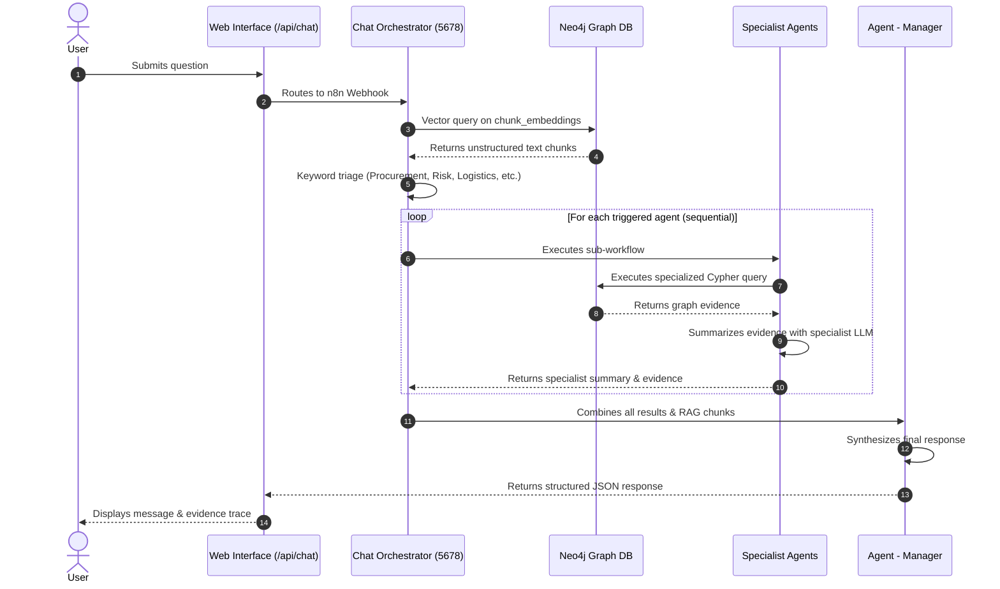

# n8n Chat Agent System Guide
## Multi-Agent GraphRAG Chat Orchestrator

This guide documents the design, specialist routing, and execution flow of the portal's multi-agent chat system.

---

## 1. System Architecture

The chat system utilizes a **triage-and-aggregate** pattern where a main orchestrator routes questions to specialized agents based on user intent, queries both structured Neo4j databases and unstructured document chunks, and compiles their findings.

---

## 2. Agent Roles and Core Responsibilities

The system consists of 7 workflows in the `n8n-workflows/` folder:

### 1. Chat Orchestrator (`Chat Orchestrator.json`)
- **Role:** Main gateway and router.
- **Workflow:**
  - Queries the Neo4j vector index to retrieve relevant unstructured context.
  - Performs intent classification (keyword triage) on the user's question.
  - Runs the selected specialist sub-workflows one after another (n8n executes sub-workflow branches sequentially, so a parallel layout brings no speed-up; see `docs/engineering-notes.md`).
  - Combines the structured specialist data and unstructured chunks.

### 2. Procurement Specialist (`Agent - Procurement Specialist.json`)
- **Role:** Analyzes supplier capacity, canonical actors, and sourcing.
- **Triage Keywords:** `supplier`, `sourcing`, `vendor`, `purchase order`, `po`, `lead time`.
- **Cypher Target:** Scans `Actor` nodes with supplier/manufacturer roles and checks `SUPPLIES` relationships.

### 3. Logistics Specialist (`Agent - Logistics Specialist.json`)
- **Role:** Analyzes shipments, delivery timelines, and geographic risk.
- **Triage Keywords:** `shipment`, `transport`, `route`, `delivery`, `freight`, `carrier`, `location`.
- **Cypher Target:** Scans `Location` and `Transport` nodes, as well as transit vectors.

### 4. Risk Analyst (`Agent - Risk Analyst.json`)
- **Role:** Identifies supply bottlenecks, maintenance alerts, and compliance risks.
- **Triage Keywords:** `risk`, `delay`, `bottleneck`, `critical`, `failure`, `incident`, `audit`, `maintenance`.
- **Cypher Target:** Scans `Risk`, `IncidentReport`, `AuditFinding`, and `MaintenanceEvent` nodes.

### 5. Sustainability Analyst (`Agent - Sustainability Analyst.json`)
- **Role:** Investigates carbon footprints, emission reports, and material waste.
- **Triage Keywords:** `carbon`, `emission`, `co2`, `recycling`, `waste`, `sustainability`, `environment`.
- **Cypher Target:** Scans `Material` properties and environmental records.

### 6. Quality Analyst (`Agent - Quality Analyst.json`)
- **Role:** Audits manufacturing defects, test reports, and component tolerances.
- **Triage Keywords:** `quality`, `test`, `defect`, `inspection`, `audit`, `report`.
- **Cypher Target:** Scans `TestReport` nodes and quality parameters.

### 7. Agent - Manager (`Agent - Manager.json`)
- **Role:** Executive synthesis.
- **Workflow:**
  - Ingests all triggered specialist findings and unstructured RAG text blocks.
  - Reconciles conflicts (e.g., if a graph query says shipping took 2 days but a RAG PDF report mentions a customs delay).
  - Formats the final output in a strict JSON schema required by the Next.js frontend, including `keyFindings`, `recommendations`, and a telemetry trace (`evidenceTrace`).

---

## 3. Generalization & Agnosticity Design

To ensure the system works on custom datasets beyond the default EV Charger model, we enforce:
1. **Fallback Coalesce Keys:** All specialist Cypher queries coalesce identifiers starting with generic fields:
   `coalesce(n.canonical_id, n.id, n.material_id, n.unit_id)`
2. **Schema-Agnostic Nodes Parser:** The orchestrator output consolidator automatically reads whatever node types are returned without enforcing hardcoded structures.
3. **Keyword-Based Routing:** The triage system is domain-flexible, using common supply chain terms that apply to Coffee, Automotive, or General Retail datasets.
