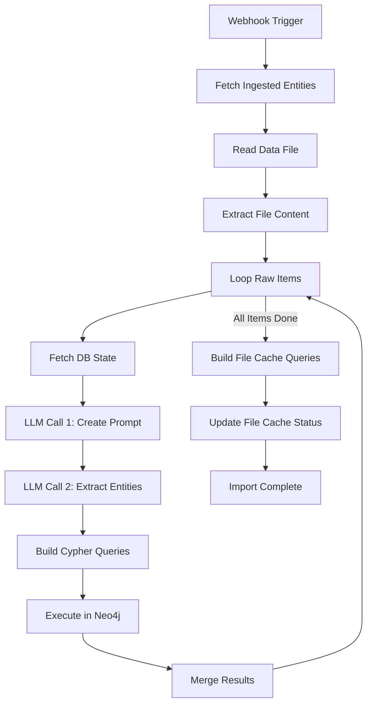

# n8n Data-Agnostic Supply Chain Pipeline Ingestion Analysis

This document provides a detailed breakdown of the `07_LLM_Entity_Extraction_v3_HTTP` workflow nodes, the specific challenges encountered and resolved during implementation, and an analysis of the Neo4j constraints and indexes.

---

## 🔍 Detailed Node-by-Node Explanation

The workflow is designed as a data-agnostic ingestion pipeline that uses a local LLM (`google/gemma-4-31B-it`) to extract entities and relationships from heterogeneous files (structured CSVs and unstructured markdown/text logs) and store them in a Neo4j Knowledge Graph.



### 1. Webhook Trigger (Webhook Node)
- **Role**: Starts the workflow via an HTTP GET request to `http://localhost:5678/webhook/trigger-extraction`.
- **Purpose**: Serves as the automated entry point for orchestrating data-processing runs.

### 2. Fetch Ingested Entities (Neo4j Node)
- **Role**: Queries Neo4j to retrieve the current cache state.
- **Query**:
  ```cypher
  CALL {
    MATCH (f:ProcessedFile)
    RETURN collect({name: f.name, hash: f.hash}) AS files
  }
  CALL {
    MATCH (n) WHERE n.hash IS NOT NULL
    RETURN collect(distinct n.hash) AS hashes
  }
  RETURN files AS existing_files, hashes AS existing_hashes
  ```
- **Purpose**: Retrieves both file-level cache hashes (`existing_files`) and row/batch-level cache hashes (`existing_hashes`).

### 3. Read Data File (Read/Write Files from Disk Node)
- **Role**: Scans the container's directory `/home/node/.n8n-files/*` (mapped to the host's `./data-processors/` directory) and loads all files.
- **Purpose**: Feeds raw data files into the pre-processing stage.

### 4. Extract File Content (Code Node)
- **Role**: Implements file and row-level pre-processing and caching logic.
  - **File-Level Cache Check**: If the file name exists in `existing_files` and its total file hash matches, the entire file is skipped immediately.
  - **Structured Files (CSVs)**: Splits rows into batches of size `5` (optimized to prevent LLM execution timeouts). For each batch, computes a `batchHash`. If the hash is found in `existing_hashes`, the batch is skipped.
  - **Unstructured Files (txt, md)**: Computes a `docHash` for the entire file. If it matches `existing_hashes`, the document is skipped.
  - **Prompt Assembly**: Appends `entityRules` defining canonical entity mapping guidelines (IDs like `A1`-`A17`, locations like `LOC_GER`, etc.) and instructs the LLM to output a strict JSON format.

### 5. Loop Raw Items (Split In Batches Node)
- **Role**: Iterates over the batch payloads output by the `Extract File Content` node sequentially (one batch at a time).
- **Purpose**: Keeps the concurrency level at 1 to manage memory and API rate limits.

### 6. Fetch DB State (Neo4j Node)
- **Role**: Pulls list of all existing Actors, Locations, Charging Stations, and Materials from Neo4j.
- **Purpose**: Feeds this list of canonical IDs into LLM Call 1, allowing the LLM to map raw values to existing entities instead of creating duplicates.

### 7. LLM Call 1: Create Prompt (HTTP Request Node)
- **Role**: Calls the local LLM cluster with the raw batch records and the existing database state.
- **Purpose**: Instructs the LLM to generate specific entity resolution instructions (e.g. mapping city names to country locations, resolving spelling variations, identifying ID overlaps).

### 8. LLM Call 2: Extract Entities (HTTP Request Node)
- **Role**: Calls the LLM again, passing the custom prompt generated by LLM Call 1 and the raw batch content.
- **Purpose**: Performs the actual extraction, returning a clean JSON schema:
  ```json
  {
    "entities": [{"entity_type", "canonical_id", "properties"}],
    "relationships": [{"from_type", "from_id", "relationship_type", "to_type", "to_id", "properties"}]
  }
  ```

### 9. Build Cypher Queries (Code Node)
- **Role**: Parses the LLM JSON, cleans markdown wrappers and `<think>` tags, and maps extracted keys to unique Cypher statements.
  - **Entity Handling**: Maps canonical IDs to unique keys (e.g. `Actor` -> `actor_id`, `Location` -> `location_code`). Wraps property names in backticks.
  - **Relationship Chaining**: Chains relationships with a `WITH 1 AS dummy MATCH ... MATCH ... MERGE ...` syntax.
  - **Query Batching**: Concatenates all statements for a single batch into a single, unified Cypher block.

### 10. Execute in Neo4j (Neo4j Node)
- **Role**: Runs the concatenated Cypher statement against the database.
- **Purpose**: Executes the batch in a single database roundtrip, guaranteeing atomic updates.

### 11. Merge Results (Code Node)
- **Role**: Collector node that routes execution back to the `Loop Raw Items` loop.

### 12. Build File Cache Queries (Code Node)
- **Role**: Scrapes execution logs for the current run to detect LLM Call 1/2 failures. For files that had 0 errors across all batches, it constructs an unwind query to merge a `ProcessedFile` cache node in Neo4j.

### 13. Update File Cache Status (Neo4j Node)
- **Role**: Commits the successfully ingested files and their file hashes to Neo4j.

### 14. Import Complete (Set Node)
- **Role**: Sets final metadata (success timestamp and status) and outputs the results.

---

## 🛠️ Issues Encountered & Resolved During Implementation

During development, we resolved several critical issues to ensure the pipeline is stable and highly performant:

1. **Conflicting Containers & SQLITE_READONLY Errors**
   - *Issue*: A duplicate docker container named `n8n` was running alongside `n8n-compose` and mounting the same SQLite database volume, causing sqlite locks.
   - *Fix*: Stopped and removed the duplicate container and cleaned temporary journal files (`.sqlite-shm` and `.sqlite-wal`).

2. **File Permissions After Database Modification**
   - *Issue*: Copying databases between the Windows host and the Linux container via `docker cp` changed file ownership to root, causing n8n to fail to boot due to read-only database locks.
   - *Fix*: Added permission repairs (`chown node:node database.sqlite`) inside the container before booting.

3. **LLM Socket Hang Up Timeouts**
   - *Issue*: Batch sizes of 25 rows caused LLM completion calls to exceed Node's 120-second default socket timeout.
   - *Fix*: Reduced the batch size to 5 rows, lowering execution duration per batch to ~40-45 seconds.

4. **n8n Nested Loop Cutoff Bug**
   - *Issue*: Nesting loops in n8n causes feedback loops to cut off subsequent items in an inner array as soon as the first item is completed.
   - *Fix*: Concatenated all batch statements into a single, unified Cypher block in JS, executing exactly 1 query node per batch.

5. **Cypher Direct MATCH Restrictions**
   - *Issue*: Chaining a `MATCH` clause directly after a `MERGE` or `SET` statement causes Cypher syntax errors.
   - *Fix*: Chained clauses using `WITH 1 AS dummy` transitions.

6. **Neo4j 5.x Unique Constraint Violation on Processes**
   - *Issue*: A constraint `process_unique` was incorrectly defined on `Process(process_id)` alone. This caused uniqueness failures because process IDs (like `P01`) are repeated across different charging station units.
   - *Fix*: Replaced it with the correct compound constraint `process_compound_key` requiring `(Process.unit_id, Process.process_id)` to be unique.

7. **Cypher Syntax Crash from Property Names with Spaces**
   - *Issue*: Unstructured text extractions (e.g. `Date Filed` in `08_incident_report_008.txt`) produced properties with spaces, resulting in Cypher syntax errors.
   - *Fix*: Updated `Build Cypher Queries` to escape and wrap all property keys in backticks (e.g., `n0.\`Date Filed\``).

8. **n8n Execution Timeout (1-Hour Cancellation)**
   - *Issue*: Sequentially processing all files took over 1 hour, hitting n8n's execution timeout limit.
   - *Fix*: The row-level caching successfully resumed from where the cancellation occurred, skipping the first 390 processed rows and finishing the remaining run in under 4 minutes.

---

## 🗄️ Neo4j Schema Constraints & Indexes

Here is the current state of constraints and indexes defined in Neo4j:

### Uniqueness Constraints
1. `station_unique` on `(cs:ChargingStation) REQUIRE cs.unit_id IS UNIQUE`
2. `actor_unique` on `(a:Actor) REQUIRE a.actor_id IS UNIQUE`
3. `location_unique` on `(l:Location) REQUIRE l.location_code IS UNIQUE`
4. `material_unique` on `(m:Material) REQUIRE m.material_id IS UNIQUE`
5. `process_compound_key` on `(p:Process) REQUIRE (p.unit_id, p.process_id) IS UNIQUE`

### Property Indexes
1. `charging_station_country` on `ChargingStation(country)`
2. `actor_country` on `Actor(country)`
3. `process_phase` on `Process(lifecycle_phase)`
4. `process_status` on `Process(status)`
5. `process_completion_date` on `Process(completion_date)`

---

## 🧐 Are these Constraints Truly Data-Agnostic?

**No, they are concept-specific rather than purely data-agnostic.**

While the pipeline's *code* is data-agnostic (it parses any raw files and properties and formats them securely), the *schema constraints* are built around specific concepts:
- **Concept-Specific Keys**: The uniqueness of nodes is enforced on specific fields (e.g. `actor_id` for Actors, `location_code` for Locations).
- **Default Fallback**: If the LLM extracts an entity label that is not defined in our `Build Cypher Queries` mapping list (like `Vehicle` or `Component`), the generator falls back to using `id` as the default key field:
  ```javascript
  const idField = label === 'Actor' ? 'actor_id' : ... : 'id';
  ```
  Since Neo4j does not have a uniqueness constraint on `Vehicle(id)`, merging these nodes may cause duplicate entries if multiple batches refer to the same vehicle.
- **Conclusion**: The pipeline supports arbitrary schemas, but to guarantee duplication-free ingestion for new entity types, unique constraints must be declared for their corresponding key fields in Neo4j.

---

## 🏗️ Why and Why Not Additional Constraints Will Be Introduced by the Workflow

### Why Additional Constraints Will NOT Be Introduced by the Workflow
1. **Administrative Privileges & Schema Locks**: Creating a constraint in Neo4j (`CREATE CONSTRAINT`) is a data definition language (DDL) operation. Executing DDL operations inside transactional data queries can cause schema locks, slowing down execution or throwing errors.
2. **Failure to Merge**: In Neo4j, you cannot execute a constraint creation command and write data in the same transaction block safely. 
3. **Runaway Schema Creation**: If n8n created constraints dynamically for every label the LLM generated, the database would quickly get clogged with garbage constraints due to LLM typos (e.g., `Charging_Station`, `ChargingStationUnit`).

### Why Additional Constraints MUST Be Introduced Manually
- **Merge Safety**: Cypher's `MERGE` statement relies on uniqueness constraints to guarantee that it performs an `ON MATCH SET` instead of creating duplicates. If an entity is merged without a constraint, Neo4j will create duplicate nodes.
- **Performance**: Enforcing constraints automatically creates underlying indexes. This makes node lookups fast, which is critical when matching existing entities during high-throughput ingestion.
- **Migration Pipeline**: Schema migrations (declaring constraints and indexes) must always be executed as a separate preparation phase before launching the n8n ingestion pipeline.
